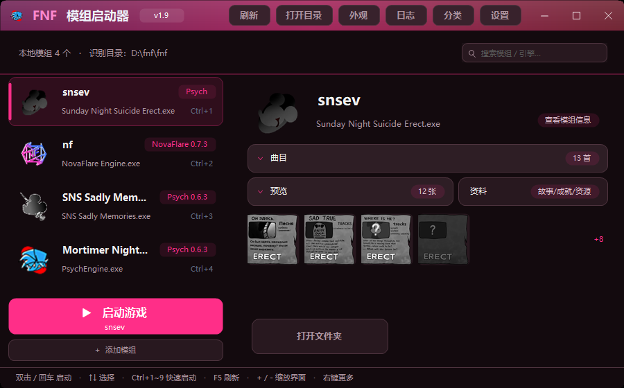

# FNF 模组启动器

一个给《Friday Night Funkin'》整合包 / 模组用的 Windows 启动器：自动扫描模组文件夹、识别引擎与版本，顺手把曲目试听、截图预览、存档备份、压缩包安装都做在一起。

界面全部自绘（无边框窗口 + 自定义控件），单文件 exe，不依赖任何第三方库。

> **English (short)** — A Windows launcher for *Friday Night Funkin'* mods and mod packs.
> It scans a mods folder and auto-detects each mod's engine/version, then adds in-app song preview, screenshot gallery, save backup, and drag-and-drop install for folders and `.zip` / `.rar` / `.7z` archives.
> Single-file exe, no installer, no third-party runtime (optional libVLC for audio preview).
> The **UI is Chinese only** — this repo is primarily for the Chinese FNF community.
> Build from source: `powershell -ExecutionPolicy Bypass -File build.ps1` (needs .NET Framework 4.x, no SDK).
> Full feature breakdown: [docs/功能与实现说明.md](docs/功能与实现说明.md). Licensed under MIT.



## 功能

**扫描与识别**
- 指定一个「识别目录」，每个子文件夹自动当做一个模组（找里面的 exe + `icon.ico`）
- 引擎与版本识别：结构特征（`lime.ndll` / `mods` / `pack.json`）+ exe 字符串签名 + 版本锚点，三重判断
- 曲目、预览图、文件数、体积、周数、角色数、音符数等元信息一次扫完，结果按签名缓存
- 启动时后台扫描，界面立即可以操作

**列表与筛选**
- 名称 / 最近启动 / 引擎三种排序，置顶优先
- 搜索支持空格分词、`分类:` `引擎:` `作者:` 前缀、首字母缩写
- 分类筛选、隐藏、置顶、重命名
- Ctrl / Shift 多选，支持批量隐藏、批量分类、批量备份存档

**详情页**
- 大图标 + 标题 + 引擎徽章；基本信息 / 运行统计两张卡
- 曲目面板：原版曲自动折叠，点击试听（合听 / 伴奏 / 人声），播放中的行有进度条
- 预览面板：截图缩略图，点开大图浏览（左右键翻页）
- 资料窗口：故事 / 成就 / 资源统计
- 窗口高度不足时自动切「紧凑版式」，信息卡让位给曲目和预览

**启动**
- 启动前体检（路径含非 ASCII、缺 `lime.ndll` / `assets` / `mods` 时提醒）
- 启动遮罩动画、最小化到托盘、托盘恢复
- 每次启动写日志；异常退出时给出退出码分析（如 `0xC0000135` = 缺 DLL / VC++ 运行库）
- 键盘按键统计（只记次数，不记录输入内容，可随时关闭）

**存档**
- 启动前自动备份存档（默认保留 5 份），也可手动「备份存档」/「恢复存档」
- 自动探测常见存档位置：`%APPDATA%\<exe名>`、Psych Engine、Flash 共享对象、模组目录下的 `saves`

**安装**
- 文件夹：拖进来即可，选择「复制到识别目录」或「只添加引用」
- 压缩包：`.zip` 内置解压，`.rar` / `.7z` 调用本机 Bandizip / 7-Zip / WinRAR
- 自动识别压缩包里真正的那一层（剥掉多余的外层目录），可给模组起名，有进度窗、可中途取消并清理残留

**外观**
- 10 套预设强调色 + 自定义色相条，整套配色跟随主色推导
- 背景图 + 浓淡滑杆
- 界面缩放（`+` / `-` / `0`）

还有：模组清单导出 / 导入、GameBanana 查新入口、桌面与开始菜单快捷方式、Lua 脚本管理、垃圾清理、诊断信息导出。

## 快速开始

1. 到 [Releases](../../releases) 下载 `FNF启动器.exe`，放到任意目录运行（**单文件，无需安装**）。
2. 首次启动会让你选「识别目录」，也就是放各个模组文件夹的那个目录。
3. 之后把模组文件夹或 `.zip` / `.rar` / `.7z` 直接拖进窗口就能加。

运行时会在 exe 同级生成：

| 路径 | 内容 |
|---|---|
| `launcher.ini` | 配置（可直接文本编辑，改完重启生效） |
| `启动日志.txt` | 每次启动 / 退出记录与退出码 |
| `backups\<模组>\<时间戳>\` | 存档快照 |

## 自己构建

需要 **.NET Framework 4.x**（Windows 10/11 自带），不需要装 SDK 或 Visual Studio。

```powershell
powershell -ExecutionPolicy Bypass -File build.ps1
```

产物在 `dist\FNF启动器.exe`。

构建脚本做的事就是调 `csc.exe`，其中 **`/codepage:65001` 不能省**：源码是无 BOM 的 UTF-8，少了它所有中文字面量会变乱码。

## 目录结构

```
src/       主程序源码（11 个 .cs，全部参与编译）
tools/     MakeIcon.cs（生成 assets/launcher.ico 的开发工具，不参与编译）
assets/    图标与站点图标
docs/      功能与实现说明、截图
build.ps1  构建脚本
```

详细的「每个功能怎么实现的」见 [docs/功能与实现说明.md](docs/功能与实现说明.md)，想自己改代码并发布见 [docs/发布步骤.md](docs/发布步骤.md)；发布时可直接抄的文案（描述 / Tags / Release 说明）见 [docs/发布文案.md](docs/发布文案.md)。

## 配置

主要配置键（`launcher.ini`）：

| 键 | 含义 |
|---|---|
| `root` | 识别目录 |
| `window` | 窗口位置尺寸 |
| `accent` | 强调色（预设名或 `hue:NNN`） |
| `sort` | 排序：`name` / `recent` / `engine` |
| `panelMode` | `inline` 合并 / `window` 窗口 |
| `minimize` | 启动后隐藏到托盘 |
| `closeAction` | 关闭行为：`ask` / `hide` / `exit` |
| `bg` / `bgAlpha` | 背景图 / 浓淡 |
| `hidden.*` `pin.*` `cat.*` `name.*` | 每个模组的隐藏、置顶、分类、显示名 |
| `arg.*` `work.*` | 每个模组的启动参数 / 工作目录 |
| `ref.*` | 外部引用目录 |
| `web.*` | 网页版条目 |

## 已知限制

- 详情页**不支持整页滚动**：窗口过矮时改用紧凑版式，把空间让给曲目和预览
- 「检查更新」只显示本地版本并打开 GameBanana 搜索页，不自动比对线上版本
- `.rar` / `.7z` 依赖本机解压工具；`.zip` 是内置解压
- 曲目试听与混音依赖 `libvlc.dll`（找不到时退化为用系统播放器打开音频）
- 键盘统计使用全局低级键盘钩子，只累加次数、不记录输入内容，可能被个别安全软件提示
- 单实例：重复启动第二个进程会静默退出（退出码 0），这不是崩溃

## 第三方说明

- 本项目**不包含**任何游戏本体、模组或素材，只提供启动与整理功能。
- `assets/siteicons/` 与 `src/SiteIcons.cs` 内嵌的 GameJolt / GameBanana / KBH Games 图标，版权归各自所有者，仅用于指代下载来源；如需商用请自行更换。
- Friday Night Funkin' 版权归 Funkin' Crew Inc. 及各模组作者所有。
- 试听功能使用 libVLC（VideoLAN，LGPL-2.1+），运行期动态加载，不随本项目分发。

## License

[MIT](LICENSE)
## 界面语言 / Language

设置窗口里可以切换 **中文 / English**（选好后点保存，启动器会自动重启生效）。
配置项是 `launcher.ini` 里的 `lang=zh|en`，不写默认中文。

翻译词条在 `i18n/core.tsv`（`中文 ⇥ English`），改完运行：

```powershell
powershell -ExecutionPolicy Bypass -File i18n/gen.ps1
powershell -ExecutionPolicy Bypass -File build.ps1
```

新增界面文字时会自动经过 `Lang.T()`（整串 → 按行 → 最长前缀 → 碎片替换 四层兜底），
没翻到的条目会原样显示中文，不会出现空白或 `[MISSING]`。